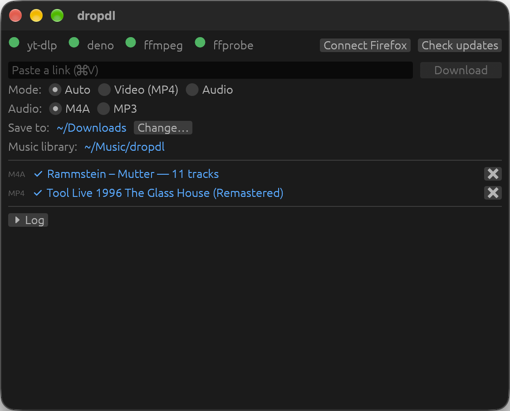

# dropdl

A small desktop app for Windows and macOS that downloads video or audio from a link. Copy a link, press **Ctrl+V** (**⌘V** on a Mac) in the window, and the download starts in a format that plays almost anywhere.



## Download

Get the latest version from [**GitHub Releases**](https://github.com/edarbieto/dropdl/releases/latest):

| System | File |
|---|---|
| Windows 10 or 11 (64-bit) | `dropdl-windows-x64.exe` |
| macOS 11 or later, Apple Silicon (M1 and newer) | `dropdl-macos-arm64.zip` |

Each release lists SHA-256 checksums and build provenance (`gh attestation verify <file> --repo edarbieto/dropdl`) so you can check that a file was built from this repository.

There is nothing to install. On Windows, put `dropdl.exe` in any folder (or on a USB drive) and run it. On macOS, unzip the file and move `dropdl.app` to Applications.

### First launch

dropdl is free and not signed with a paid certificate, so the system warns you the first time:

- **Windows:** SmartScreen says "Windows protected your PC". Click **More info**, then **Run anyway**.
- **macOS:** the first open is blocked ("dropdl" can't be opened / Apple could not verify it). Open **System Settings > Privacy & Security**, scroll down and click **Open Anyway** next to the dropdl message, then confirm.

On the first run dropdl downloads the tools it uses (about 200 MB): [yt-dlp](https://github.com/yt-dlp/yt-dlp), [deno](https://deno.com) and [ffmpeg](https://ffmpeg.org). Wait until the four indicators at the top turn green. dropdl keeps them up to date on its own.

## How to use

1. Copy a link (YouTube, YouTube Music, TikTok, Instagram, X, Vimeo, SoundCloud, …).
2. Click the dropdl window and press **Ctrl+V** (**⌘V**). The download starts right away. You can also paste into the box and press Enter.
3. Click a finished item to show the file in Explorer or Finder.

Paste as many links as you like: they wait in a queue and download one after another. Files go to your **Downloads** folder; use **Change…** to pick another one.

## What you get

- **Video sites** (YouTube, TikTok, Instagram, Facebook, X, Vimeo, Zoom, …): an **MP4** file (H.264 video, AAC audio) that plays on phones, TVs and editors.
- **Audio sites** (SoundCloud, Bandcamp, Mixcloud, Audiomack): an **M4A** file with the original audio (not re-encoded), cover art and tags. Choose **MP3** instead if your player needs it.
- **YouTube Music** songs, albums, artists and playlists go into a music library in the **dropdl** folder inside your **Music** folder:

  ```
  Music/dropdl/
    Album Artist/
      Album (Year)/
        01 - Title.m4a
        02 - Title.m4a
        cover.jpg
  ```

  Each track gets complete tags (artist, album, track and disc number, year), the album cover and lyrics (synced when available). An artist link downloads all their albums, singles and EPs. Tracks you already have are skipped, so pasting an album again only fetches what is missing.

To get only the audio of a video (or a video from a music site), switch the mode from **Auto** to **Audio** or **Video**.

## Sites that need a login

Instagram, Facebook, and private or age-restricted videos only work when you are logged in. dropdl can use your **Firefox** login:

1. Log in to the site in Firefox.
2. In dropdl, click **Connect Firefox**, then **Connect**.

dropdl never copies or uploads your cookies: yt-dlp reads them from Firefox on your computer at download time. Only Firefox is supported, because other browsers lock their cookies away from other apps.

**macOS:** macOS blocks apps from reading other apps' data. If dropdl says so, click **Open Privacy Settings**, add `dropdl.app` under **Full Disk Access**, and restart dropdl. After updating dropdl, remove it from that list and add it again. More in [docs/cookies.md](docs/cookies.md).

## Privacy

dropdl has no account, no telemetry and no ads. It only connects to:

- the sites of the links you paste (through yt-dlp),
- YouTube Music, [MusicBrainz](https://musicbrainz.org) and [LRCLIB](https://lrclib.net), for music library tags, covers and lyrics,
- GitHub, gyan.dev (Windows) and martin-riedl.de (macOS), to download and update its tools.

## Limitations

- Windows (64-bit) and Macs with Apple Silicon only. Intel Macs can build it from source; Linux is planned.
- Only Firefox can be connected for logins.
- Zoom recordings protected by a passcode are not supported.
- Some sites block certain networks or need a login (see above).
- Only download content you have the right to download.

If something fails, open the **Log** in dropdl and include it when you [report an issue](https://github.com/edarbieto/dropdl/issues).

## For developers

dropdl is written in Rust with [egui](https://github.com/emilk/egui). It requires Rust (stable, edition 2024).

```sh
scripts/build-release.ps1      # Windows → dist/dropdl.exe (portable, dependency-checked)
scripts/bundle-macos.sh        # macOS → dist/dropdl.app + zip (ad-hoc signed)
cargo test                     # unit tests (offline)
cargo test -- --ignored --nocapture   # end-to-end tests (network, see docs/testing.md)
```

Contributions are welcome: see [CONTRIBUTING.md](CONTRIBUTING.md).

Documentation:

- [docs/architecture.md](docs/architecture.md): how the code is organized
- [docs/download-rules.md](docs/download-rules.md): which format each link gets, and why
- [docs/tooling.md](docs/tooling.md): data folders, and how tools are validated, installed and updated
- [docs/cookies.md](docs/cookies.md): the "Connect Firefox" feature and troubleshooting
- [docs/music-library.md](docs/music-library.md): music library mode for YouTube Music
- [docs/platforms.md](docs/platforms.md): Windows/macOS differences, planned Linux support
- [docs/testing.md](docs/testing.md): how to test
- [docs/release.md](docs/release.md): release builds, size measurements, icon, license notices and publishing
- [CHANGELOG.md](CHANGELOG.md) and [ROADMAP.md](ROADMAP.md)

## License

Licensed under either of [Apache License, Version 2.0](LICENSE-APACHE) or [MIT license](LICENSE-MIT), at your option. The licenses of the Rust crates compiled into dropdl are in [THIRD-PARTY-LICENSES.txt](THIRD-PARTY-LICENSES.txt).

Unless you explicitly state otherwise, any contribution intentionally submitted for inclusion in dropdl by you, as defined in the Apache-2.0 license, shall be dual licensed as above, without any additional terms or conditions.

dropdl downloads [yt-dlp](https://github.com/yt-dlp/yt-dlp) (Unlicense), [deno](https://deno.com) (MIT) and an ffmpeg build (GPL; [gyan.dev](https://www.gyan.dev/ffmpeg/builds/) on Windows, [martin-riedl.de](https://ffmpeg.martin-riedl.de) on macOS) from their official releases at runtime and runs them as separate programs. They are not part of dropdl and keep their own licenses.
